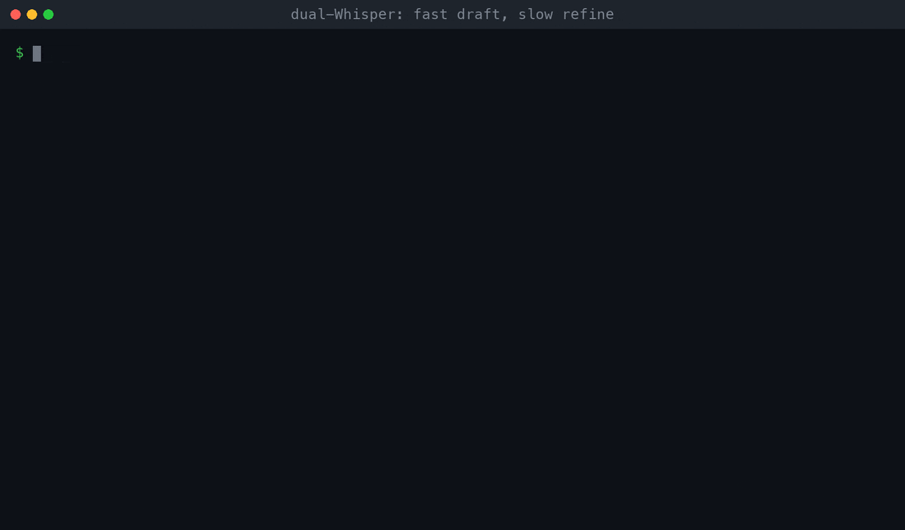
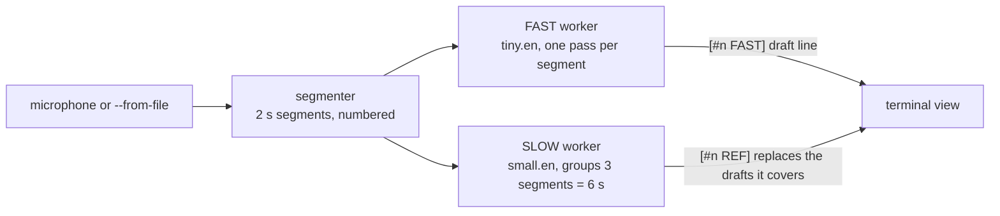

# ossAI live transcribe

Live speech-to-text with two Whisper models running side by side. A small model prints a rough draft every 2 seconds. A larger model re-reads the same audio in 6 second windows and replaces the draft with a cleaner version a moment later. You get words on screen almost at once and an accurate transcript shortly after.



In the recording, `tiny.en` hears "pre-emerge" and "Qberneats". A few seconds later `small.en` corrects the window to "Kubernetes config". The same happens for "Postgres and SQLite". The GIF is real output from `--from-file`, a bundled 18 second clip (`samples/standup.wav`) streamed through the pipeline at real-time speed.

## How it works



- The segmenter cuts audio into fixed-length segments and sends each one to both workers.
- The fast worker transcribes every segment on its own, strips punctuation (a 2 s cut rarely ends a sentence), and updates a single live line.
- The slow worker waits until it holds one full window, transcribes it once with a temperature fallback and repetition guards, and swaps the refined text in for the drafts it covers.
- Near-silent segments are skipped.

The tradeoff is latency against accuracy. The draft costs one small-model pass per segment. The refinement lands roughly one window plus one slow-model pass after the words were spoken, and the slow model also needs more CPU. Shorter windows give faster corrections with less context, so the corrected text is less accurate. Longer windows do the opposite. On CPU a larger refiner can fall behind real time, as in the GIF, which was recorded on a busy laptop. A GPU shrinks both gaps.

## Install

Requires Python 3.13 or older. Tested on Python 3.12 (macOS, CPU).

```bash
git clone https://github.com/Kipung/ossAI_live_transcribe
cd ossAI_live_transcribe
python3.12 -m venv .venv && source .venv/bin/activate
pip install -r requirements.txt
```

`pyaudio` needs PortAudio (`brew install portaudio` on macOS). Model weights download on first run and are cached by `openai-whisper`. `small.en` is about 480 MB.

## Run

Reproduce the demo with no microphone:

```bash
python hybrid_transcribe_dual_whisper.py --from-file samples/standup.wav --plain
```

Live from the microphone:

```bash
python hybrid_transcribe_dual_whisper.py --list-devices
python hybrid_transcribe_dual_whisper.py --fast-model tiny.en --slow-model small.en --device-index 1
```

| Option | Default | Meaning |
| --- | --- | --- |
| `--fast-model` | `tiny.en` | Draft model |
| `--slow-model` | `small.en` | Refinement model. `base.en` is lighter, `medium.en` is slower and better |
| `--fast-segment-seconds` | `2.0` | Draft cadence |
| `--slow-segment-seconds` | `6.0` | Refinement window |
| `--from-file WAV` | off | Stream a 16 kHz mono 16-bit WAV in real time instead of the microphone |
| `--plain` | off | One timestamped line per update instead of redrawing the screen |
| `--list-devices`, `--device-index` | | Choose a microphone |

To make your own clip: `ffmpeg -i in.m4a -ar 16000 -ac 1 -c:a pcm_s16le out.wav`.

## Repository layout

- `hybrid_transcribe_dual_whisper.py` is the project.
- `samples/standup.wav` is a generated test clip.
- `experiments/` holds earlier Vosk and Tkinter variants. See its README.

An earlier commit contained a real recording transcript, `transcript.txt`. It is removed from the tree but remains in git history.

## Where this fits

This project grew out of [ossAI_transcribe](https://github.com/Kipung/ossAI_transcribe), which transcribes files offline. The same idea, record, transcribe and summarize, became [meeting-notes-electron](https://github.com/Kipung/meeting-notes-electron).

## Credits

Built by [Kipung](https://github.com/Kipung) with Joshua Parsio, who co-authored the project (4 commits in this repository's history).
